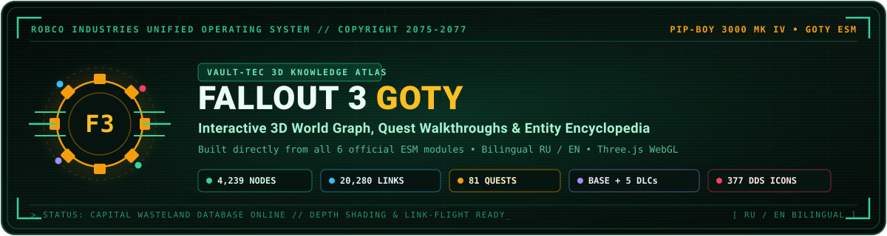
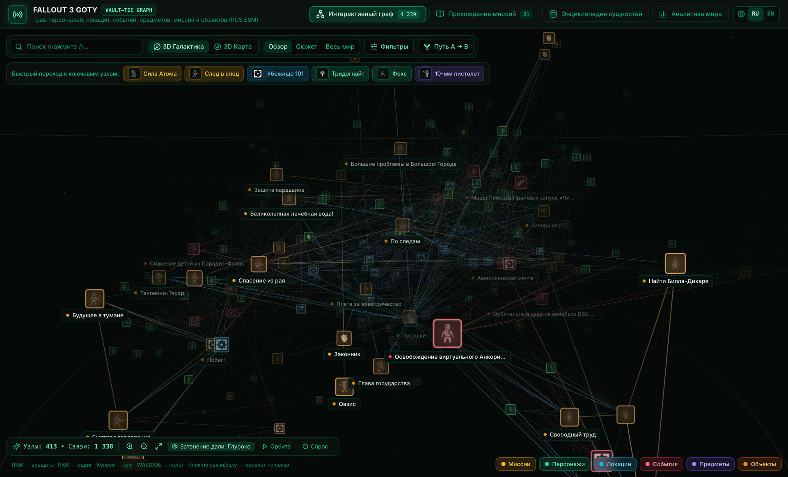
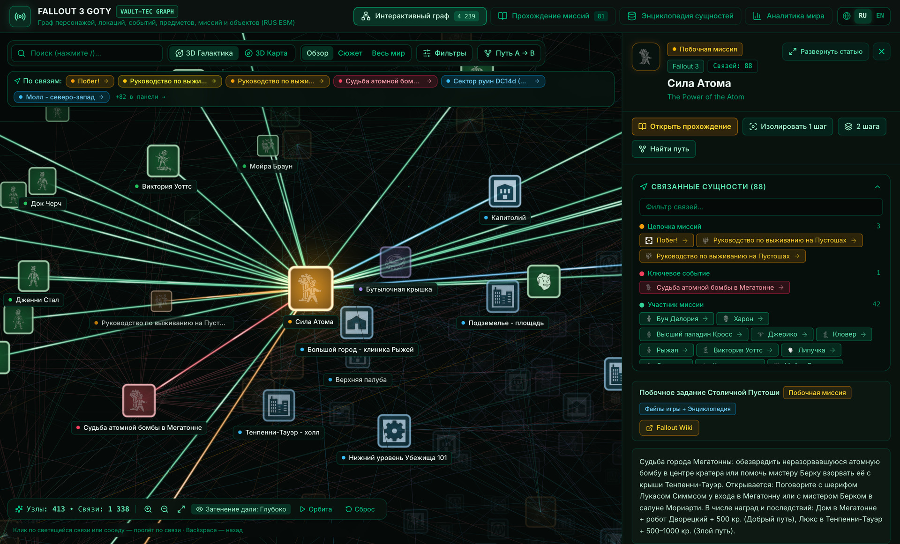
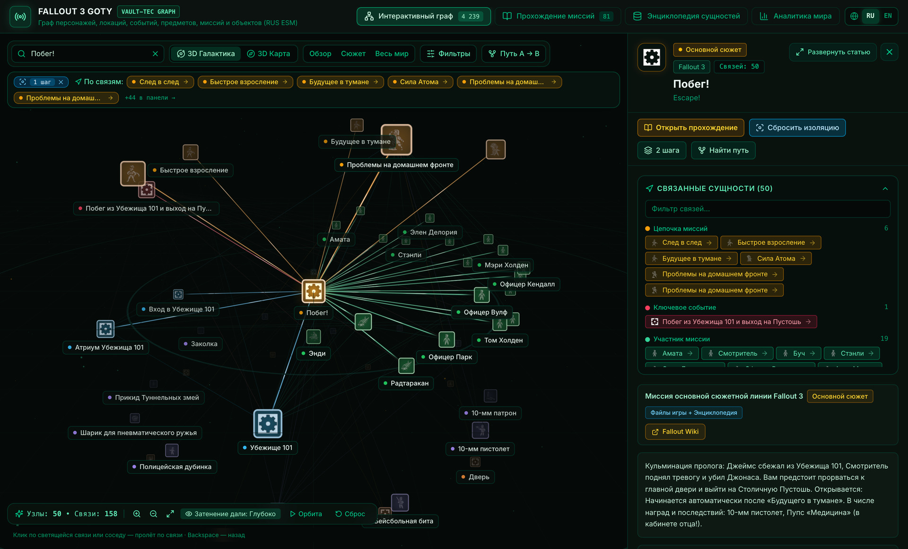
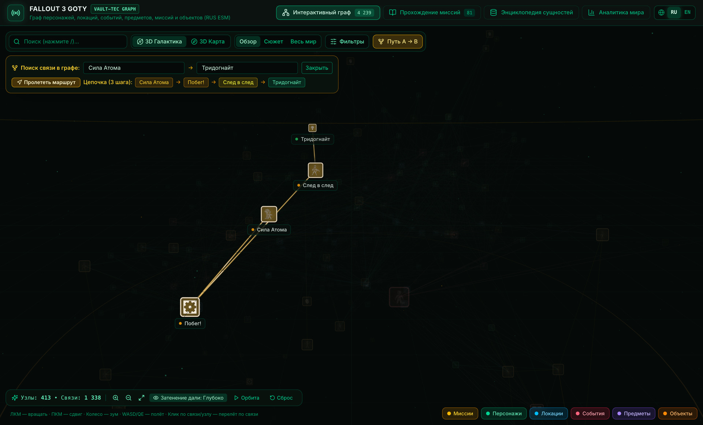
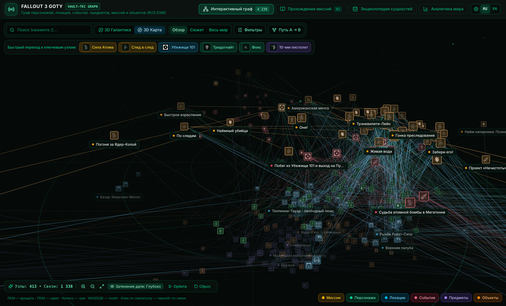
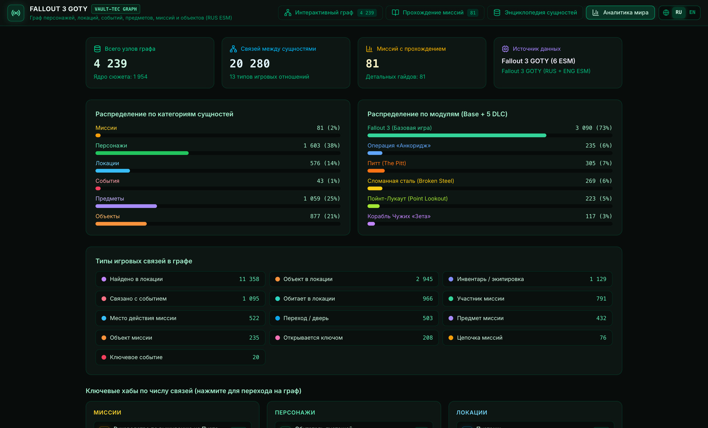
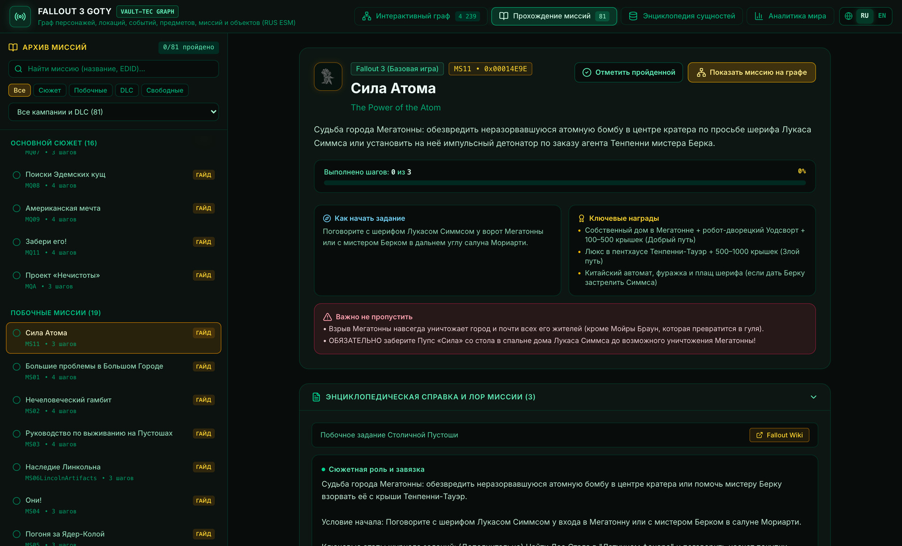
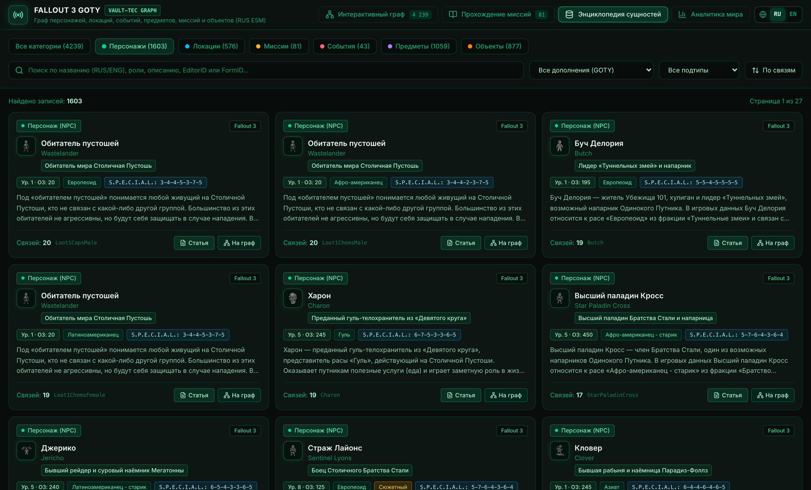

<div align="center">



<br />

[](README.md)
[](README.ru.md)
[](https://threejs.org/)
[](https://react.dev/)
[](#telemetry)

</div>

```text
ROBCO INDUSTRIES UNIFIED OPERATING SYSTEM
COPYRIGHT 2075-2077 ROBCO INDUSTRIES
-SERVER 101: CAPITAL WASTELAND TACTICAL HOLOTAPE-

> MOUNTING ARCHIVES: Fallout3.esm | Anchorage.esm | ThePitt.esm | BrokenSteel.esm | PointLookout.esm | Zeta.esm
> INDEXED RECORDS  : 4,239 ENTITIES  •  20,280 RELATIONSHIPS  •  81 QUEST GUIDES  •  377 DDS PIP-BOY ICONS
> OPTICAL SUBSYSTEM: 3D DEPTH SHADING ONLINE  •  CORRIDOR LINK-FLIGHT ENGAGED  •  BILINGUAL [RU / EN]
```

**Fallout 3 GOTY — Vault-Tec Knowledge Graph** is an interactive bilingual (**RU / EN**) 3D web encyclopedia and quest atlas for *Fallout 3: Game of the Year Edition*. Extracted directly from all **6 official `.ESM` master files** and `.BSA` archives, it maps every character, location, quest, story event, item, perk, and terminal across the Capital Wasteland into a navigable **Three.js WebGL** universe.

<p align="center">
  
  <br />
  <sub><b>[ MODE: 3D GALAXY // OVERVIEW ]</b> — Foreground hubs and narrative arteries glow crisply while distant clusters smoothly shade into deep Pip-Boy space.</sub>
</p>


## `// 01. VISUAL TERMINAL SHOWCASE`

### Corridor Flight Along Connections & Hub Inspection
Select any quest, character, or landmark to illuminate its semantic web of relationships. Click **directly on any glowing 3D connection beam** (or connected neighbor) to align your camera with the link vector and **fly through 3D space from one entity to the next**, complete with directional energy pulses and flight-history breadcrumbs (`← Back`).

<p align="center">
  
  <br />
  <sub><b>[ HUB LOCK: THE POWER OF THE ATOM ]</b> — Semantic connection beams (amber quests, rose story events, emerald NPCs, sky-blue locations), quick-fly HUD bar, and right-hand Pip-Boy dossier.</sub>
</p>

<table>
  <tr>
    <td width="50%" valign="top">
      
      <p align="center"><sub><b>3D FOCUS (1-HOP / 2-HOP ISOLATION)</b><br/>Double-click any node to rearrange its immediate neighborhood into a stratified, collision-free 3D radial constellation.</sub></p>
    </td>
    <td width="50%" valign="top">
      
      <p align="center"><sub><b>SHORTEST PATH FINDER (A → B) &amp; AUTO-TOUR</b><br/>Trace the shortest narrative chain between any two Wasteland entities and hit <b>Fly Path</b> for an automated multi-hop tour.</sub></p>
    </td>
  </tr>
  <tr>
    <td width="50%" valign="top">
      
      <p align="center"><sub><b>TACTICAL 3D WASTELAND MAP</b><br/>Switch from abstract knowledge galaxy to true Wasteland spatial coordinates (<code>mapX</code>, <code>mapY</code>, <code>mapZ</code>) over a holographic radar grid.</sub></p>
    </td>
    <td width="50%" valign="top">
      
      <p align="center"><sub><b>WORLD ANALYTICS TERMINAL</b><br/>Statistical breakdown across all 6 entity categories, 6 GOTY modules, 13 relationship types, and top Wasteland hubs.</sub></p>
    </td>
  </tr>
  <tr>
    <td width="50%" valign="top">
      
      <p align="center"><sub><b>QUEST WALKTHROUGHS &amp; MORAL BRANCHES (81)</b><br/>Step-by-step checklists, skill checks, Good/Evil/Neutral outcomes, missable bobblehead alerts, and raw <code>.ESM</code> Pip-Boy stage logs.</sub></p>
    </td>
    <td width="50%" valign="top">
      
      <p align="center"><sub><b>VAULT-TEC ENTITY ENCYCLOPEDIA (4,239)</b><br/>Instant bilingual search by name, role, <code>EditorID</code>, or <code>FormID</code> with S.P.E.C.I.A.L. stats, V.A.T.S. weapon specs, and terminal logs.</sub></p>
    </td>
  </tr>
</table>


## `// 02. PIP-BOY SUBSYSTEMS & CAPABILITIES`

### `A. Interactive 3D WebGL Knowledge Graph`
- **Adaptive GPU Depth Shading**: Custom GLSL shaders attenuate brightness, opacity, and card scale by camera focal depth — foreground objects stay razor-sharp while far-side clutter recedes into dark Pip-Boy space (`Deep` / `Soft` / `Off` modes).
- **3D Spatial De-Clumping & Zero Overexposure**: Spatial-hash 3D separation prevents overlapping plaques across all density tiers, while `NormalBlending` ribbons with plaque-border cutouts keep even 140+ link hubs crisp without whiteout glow.
- **Corridor Link-Flight Navigation**:
  - Hover any 3D connection beam to inspect its relationship type and target (`Quest Location: Escape! → Vault 101`).
  - Click any beam, connected neighbor, or HUD link pill to swoop onto the connection corridor and fly directly from node `A` to node `B` along a cubic Bézier trajectory guided by a light pulse.
  - Retrace your journey step-by-step with **`← Back`** (`Backspace`).
- **Dual Layouts & Three Density Scopes**:
  - **3D Galaxy** vs **3D Map** (`mapX`, `mapY`, `mapZ`).
  - **Overview / Atlas** (`413` key landmarks) · **Story Core** (`1,954` quest-linked nodes) · **Full World** (`4,239` GOTY entities).
- **Custom WebGL Icon Atlas**: **377** authentic Pip-Boy icons extracted from game `.BSA` / `.DDS` archives and rendered on instanced SDF rounded plaques.

### `B. Curated Quest Archive & Pip-Boy Stage Logs (81 Quests)`
- Complete walkthroughs for **Main Storyline (16)**, **Side Quests (19)**, **Freeform / Unmarked Quests (17)**, **Operation: Anchorage (4)**, **The Pitt (4)**, **Broken Steel (6)**, **Point Lookout (12)**, and **Mothership Zeta (3)**.
- Persistent progress tracking per quest and individual step.
- **Skill checks**, **Good / Evil / Neutral / Alternative branches**, **key rewards**, **missable item warnings**, plus official `.ESM` **Pip-Boy Objectives (`QOBJ`)** and **Stage Logs (`INDX / CNAM`)**.

### `C. Complete Entity Encyclopedia (4,239 Dossiers)`
- **Characters & Creatures (`1,603`)**: Race, level, HP, Essential/Unique flags, AI behavior, full **S.P.E.C.I.A.L.** attribute bars, factions, merchant/companion services, inventory, and dialogue quotes.
- **Weapons, Apparel & Items (`1,059`)**: Damage, DR, ammo type, clip size, fire rate, **V.A.T.S. AP cost**, crit damage/multiplier, spread, durability, cap value, weight, effects, unlocked containers/doors, and full note/holotape transcripts.
- **Locations & World Objects (`1,453`)**: Worldspace, map marker type, lockpick/hack difficulty, full **RobCo terminal menu entries**, and perks.

### `D. Instant Bilingual Engine (RU / EN)`
- One-click **`RU | EN`** toggle in the top header (persisted in `localStorage` and addressable via `?lang=ru` / `?lang=en`), dynamically switching UI strings, node labels, walkthroughs, and encyclopedia entries with in-memory caching.


## `// 03. FLIGHT & NAVIGATION CONTROLS`

| Control / Input | Pip-Boy Action |
| :--- | :--- |
| <kbd>Click</kbd> **on Node / Link Beam** | Fly along the 3D connection corridor to the target entity & open its dossier |
| <kbd>Double-Click</kbd> **on Node** | Activate **3D Focus** (1-hop / 2-hop isolated radial constellation) |
| <kbd>Backspace</kbd> | Fly back along the previous connection in your flight history (`← Back`) |
| <kbd>LMB Drag</kbd> / <kbd>RMB Drag</kbd> | Orbit 3D camera around target / Pan viewport |
| <kbd>Mouse Wheel</kbd> | Zoom camera in / out |
| <kbd>W</kbd> <kbd>A</kbd> <kbd>S</kbd> <kbd>D</kbd> + <kbd>E</kbd> / <kbd>Q</kbd> | Free 6-DOF flight in true 3D gaze direction (`Space` / `E` up, `Q` down) |
| <kbd>/</kbd> | Focus instant search bar (`EditorID`, `FormID`, EN & RU names) |
| <kbd>R</kbd> / <kbd>Esc</kbd> | Re-center camera (`R`) / Close drawers & clear selection (`Esc`) |


<a id="telemetry"></a>

## `// 04. VAULT-TEC TELEMETRY & DATASET METRICS`

```text
┌──────────────────────────────────────────────────────────┬────────────────────┐
│ VAULT-TEC ARCHIVE METRIC                                 │       RECORD COUNT │
├──────────────────────────────────────────────────────────┼────────────────────┤
│ Total Knowledge Graph Entities                           │              4,239 │
│ Total Cross-Entity Relationships (13 Semantic Types)     │             20,280 │
│ Story Core Entities (Quests, Landmarks, Key Actors)      │              1,954 │
│ Atlas Overview Hubs                                      │                413 │
│ Curated Quest Walkthroughs (RU & EN)                     │                 81 │
│ Bilingual Encyclopedia Dossiers (RU & EN)                │              4,239 │
│ Extracted BSA/DDS Pip-Boy Atlas Icons                    │                377 │
└──────────────────────────────────────────────────────────┴────────────────────┘

ENTITY CATEGORIES                              ESM MODULES (GOTY)
Characters  ████████████████░░  1,603 (38%)    Fallout 3 (Base)   ████████████████░░  3,090 (73%)
Items       ██████████░░░░░░░░  1,059 (25%)    The Pitt           ██░░░░░░░░░░░░░░░░    305  (7%)
Objects     ████████░░░░░░░░░░    877 (21%)    Broken Steel       ██░░░░░░░░░░░░░░░░    269  (6%)
Locations   ██████░░░░░░░░░░░░    576 (14%)    Op: Anchorage      ██░░░░░░░░░░░░░░░░    235  (6%)
Quests      █░░░░░░░░░░░░░░░░░     81  (2%)    Point Lookout      ██░░░░░░░░░░░░░░░░    223  (5%)
Events      █░░░░░░░░░░░░░░░░░     43  (1%)    Mothership Zeta    █░░░░░░░░░░░░░░░░░    117  (3%)
```


## `// 05. ROBCO TERMLINK BOOT SEQUENCE (QUICK START)`

> [!TIP]
> **Zero Game Files Required:** All prebuilt JSON datasets (`public/data/`) and packed Pip-Boy icon atlases (`public/icons/`) are included in the repository. Clone, install, and launch in seconds.

### Prerequisites
- **Node.js** `18+` and **npm**

### Local Development
```bash
git clone https://github.com/harriedgemusic/f3-graph.git
cd f3-graph
npm install
npm run dev
```

### Production Build
```bash
npm run build
npm run preview
```

<details>
<summary><b>📂 Inspect Repository Architecture &amp; Data Pipeline</b></summary>

```text
f3-graph/
├── docs/screenshots/              # SVG CRT banners & high-DPI terminal showcase shots
├── public/
│   ├── data/
│   │   ├── graph.json             # 4,239 nodes & 20,280 edges with 3D Galaxy & Map coords
│   │   ├── details.json           # Russian encyclopedia dossiers (4,239)
│   │   ├── details.en.json        # English encyclopedia dossiers (4,239)
│   │   ├── walkthroughs.json      # Russian quest walkthroughs (81)
│   │   └── walkthroughs.en.json   # English quest walkthroughs (81)
│   └── icons/
│       ├── atlas.png              # Packed Pip-Boy WebGL texture atlas
│       ├── atlas.json             # UV coordinates & color flags for 377 icons
│       └── *.png                  # Extracted DDS-to-PNG Fallout 3 icons
├── scripts/                       # Python/C ESM & BSA parsers, 3D layout & localization scripts
└── src/
    ├── App.tsx                    # Pip-Boy shell, tab router & RU/EN language switcher
    ├── constants.ts               # Entity, DLC, edge & subtype metadata + Pip-Boy palette
    ├── i18n.tsx                   # Bilingual UI strings & localization context
    ├── types.ts                   # Strict TypeScript definitions
    ├── data/useFalloutData.ts     # Cached localized loader & semantic adjacency ranking
    └── components/
        ├── GraphView.tsx          # Custom GLSL Three.js 3D renderer, depth shader & link-flight
        ├── InspectorPanel.tsx     # Quick-fly links, isolation controls & entity dossier
        ├── WalkthroughsView.tsx   # Quest archive, interactive checklists & ESM QOBJ logs
        ├── CatalogView.tsx        # Searchable entity encyclopedia
        ├── EncyclopediaDetailsBlock.tsx
        ├── EntityIcon.tsx
        └── StatsView.tsx          # World analytics & top Wasteland hubs
```

</details>

## `// 06. TECH STACK`

- **Frontend Core**: React 19 · TypeScript 5.7 · Vite 6 · Tailwind CSS 4
- **3D WebGL Engine**: Three.js (custom instanced GLSL billboard & ribbon shaders, GPU depth shading, cubic Bézier corridor flight, `OrbitControls`) · Graphology · Lucide React
- **ESM Data Pipeline**: Python 3 & C tools (`scripts/`) for binary `.ESM` / `.BSA` extraction, `.DDS` icon atlas packing, 3D force/geographic layout generation, and bilingual wiki/ESM synthesis

---

<div align="center">
  <sub>
    <b>VAULT-TEC LEGAL NOTICE // DISCLAIMER</b><br />
    Fan-made, non-commercial educational and reference project.<br />
    <i>Fallout 3</i>, <i>Pip-Boy</i>, <i>Vault-Tec</i>, <i>RobCo Industries</i>, and all related trademarks, characters, lore, and game assets are the property of <b>Bethesda Softworks LLC / ZeniMax Media Inc.</b>
  </sub>
</div>
