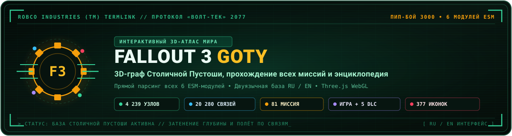
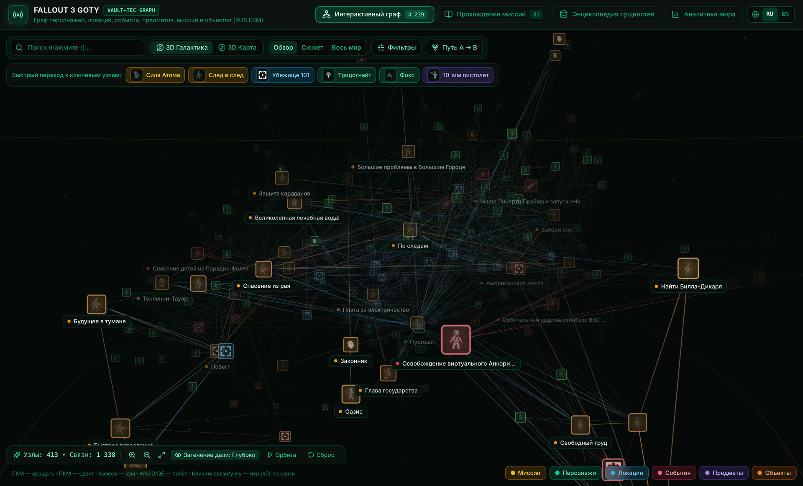
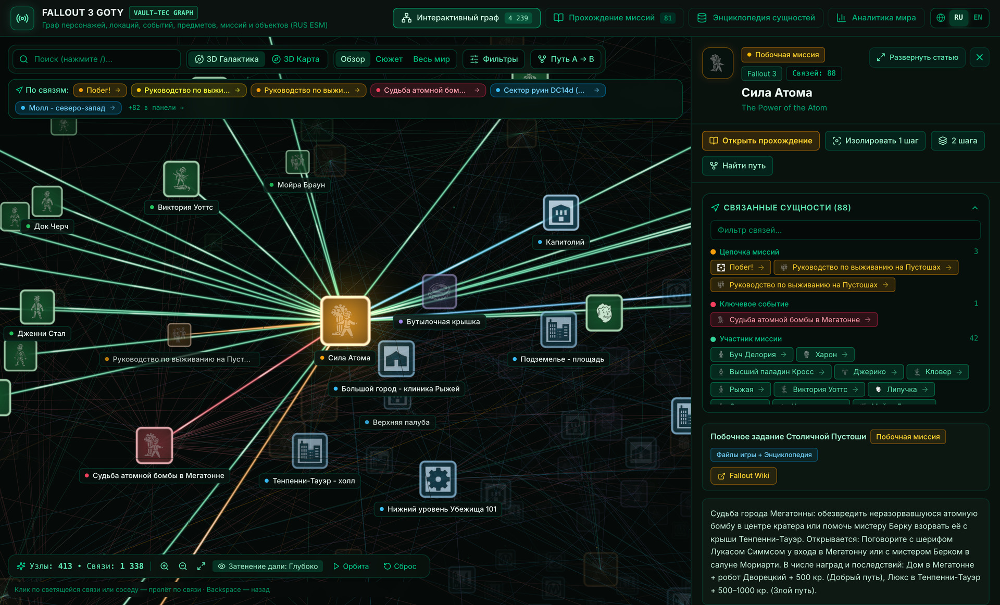
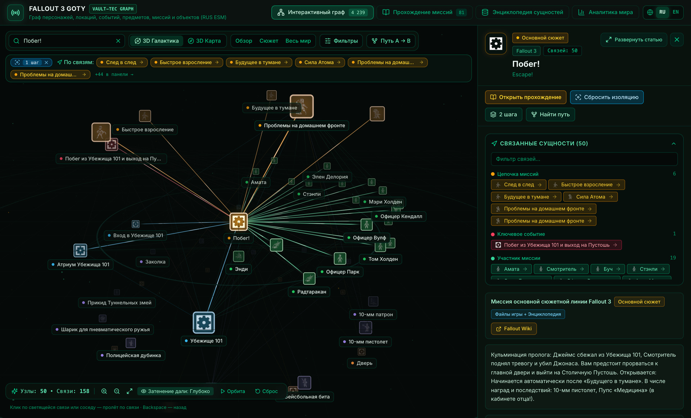
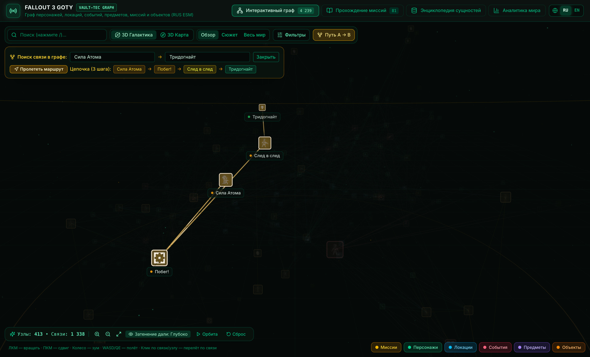
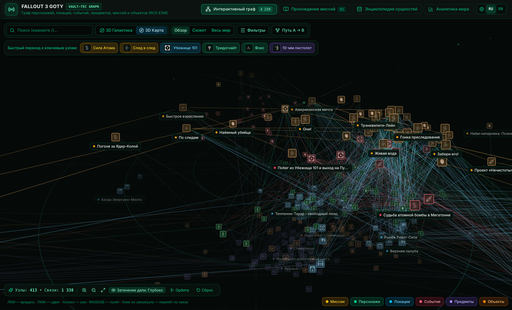
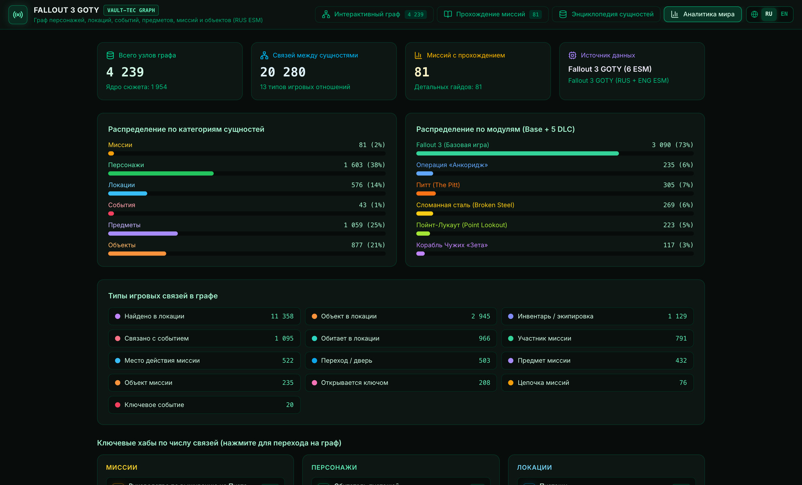
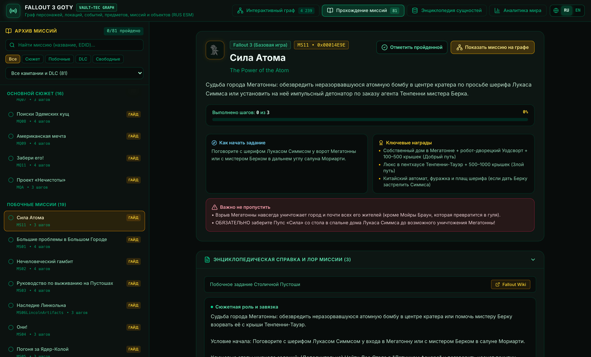
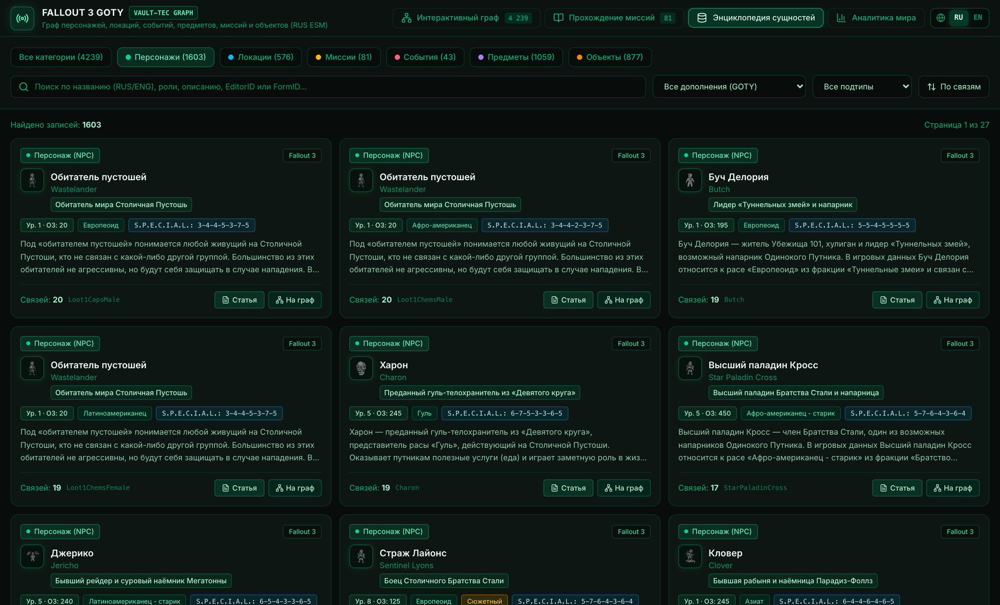

<div align="center">



<br />

[](README.md)
[](README.ru.md)
[](https://threejs.org/)
[](https://react.dev/)
[](#telemetry)

</div>

```text
ЕДИНАЯ ОПЕРАЦИОННАЯ СИСТЕМА ROBCO INDUSTRIES (TM)
АВТОРСКОЕ ПРАВО 2075-2077 ROBCO INDUSTRIES
-СЕРВЕР 101: ТАКТИЧЕСКИЙ ГОЛОДИСК СТОЛИЧНОЙ ПУСТОШИ-

> ПОДКЛЮЧЕНИЕ МОДУЛЕЙ : Fallout3.esm | Anchorage.esm | ThePitt.esm | BrokenSteel.esm | PointLookout.esm | Zeta.esm
> ИНДЕКС БАЗЫ ДАННЫХ  : 4 239 СУЩНОСТЕЙ  •  20 280 СВЯЗЕЙ  •  81 ГАЙД ПО МИССИЯМ  •  377 ИКОНОК ПИП-БОЯ
> ОПТИЧЕСКАЯ СИСТЕМА  : 3D-ЗАТЕНЕНИЕ ДАЛИ АКТИВНО  •  КОРИДОРНЫЙ ПОЛЁТ ПО СВЯЗЯМ  •  ЯЗЫКИ [RU / EN]
```

**Fallout 3 GOTY — Интерактивный 3D-граф мира Волт-Тек** — это двуязычный (**RU / EN**) интерактивный 3D-атлас, путеводитель по квестам и полная энциклопедия мира *Fallout 3: Game of the Year Edition*. Проект собран напрямую из всех **6 официальных `.ESM`-файлов** и `.BSA`-архивов игры и объединяет персонажей, локации, миссии, сюжетные события, оружие, предметы, перки и терминалы Столичной Пустоши в едином трёхмерном пространстве на **Three.js WebGL**.

<p align="center">
  
  <br />
  <sub><b>[ РЕЖИМ: 3D ГАЛАКТИКА // ОБЗОР ]</b> — Ближние ориентиры и сюжетные артерии ярко выделены, а дальние кластеры плавно уходят в глубокую тень Пип-Боя.</sub>
</p>


## `// 01. ВИЗУАЛЬНЫЙ ОБЗОР ТЕРМИНАЛА`

### Пролёт по связям между объектами и досье узлов
Выберите любую миссию, персонажа или локацию — её связи мгновенно раскроются цветными направленными лучами с бегущими импульсами. Нажмите **прямо на светящийся луч связи в 3D** (или на связанного соседа), чтобы камера выстроилась вдоль вектора связи и **пролетела сквозь граф от одного объекта к другому**, сохраняя цепочку маршрута для возврата кнопкой `← Назад`.

<p align="center">
  
  <br />
  <sub><b>[ ЗАХВАТ ЦЕЛИ: «СИЛА АТОМА» ]</b> — Направленные лучи связей (янтарные миссии, алые события, изумрудные NPC, голубые локации), верхний бар быстрого перелёта и досье Пип-Боя справа.</sub>
</p>

<table>
  <tr>
    <td width="50%" valign="top">
      
      <p align="center"><sub><b>3D-ФОКУС (ИЗОЛЯЦИЯ НА 1 ИЛИ 2 ШАГА)</b><br/>Двойной клик по узлу перестраивает его окружение в просторное многоуровневое 3D-созвездие без наложений карточек.</sub></p>
    </td>
    <td width="50%" valign="top">
      
      <p align="center"><sub><b>ПОИСК СВЯЗИ (A → B) И ПРОЛЁТ МАРШРУТА</b><br/>Находит кратчайшую сюжетную цепочку между любыми двумя сущностями Пустоши и проводит камеру по всему маршруту.</sub></p>
    </td>
  </tr>
  <tr>
    <td width="50%" valign="top">
      
      <p align="center"><sub><b>ТАКТИЧЕСКАЯ 3D-КАРТА ПУСТОШИ</b><br/>Переключение из абстрактной галактики в реальные игровые координаты мира (<code>mapX</code>, <code>mapY</code>, <code>mapZ</code>) над голографической радарной сеткой.</sub></p>
    </td>
    <td width="50%" valign="top">
      
      <p align="center"><sub><b>ТЕРМИНАЛ АНАЛИТИКИ МИРА</b><br/>Диаграммы распределения по 6 категориям, 6 модулям GOTY, 13 типам игровых отношений и рейтинг главных хабов Пустоши.</sub></p>
    </td>
  </tr>
  <tr>
    <td width="50%" valign="top">
      
      <p align="center"><sub><b>АРХИВ МИССИЙ И РАЗВИЛОК (81 ГАЙД)</b><br/>Чек-листы прохождения, проверки навыков, добрый/злой пути, предупреждения о пупсах и подлинные записи стадий из <code>.ESM</code>.</sub></p>
    </td>
    <td width="50%" valign="top">
      
      <p align="center"><sub><b>ЭНЦИКЛОПЕДИЯ СУЩНОСТЕЙ ВОЛТ-ТЕК (4 239)</b><br/>Мгновенный поиск по RU/EN названиям, ролям, <code>EditorID</code> и <code>FormID</code> со шкалами S.P.E.C.I.A.L., ТТХ оружия в V.A.T.S. и текстами терминалов.</sub></p>
    </td>
  </tr>
</table>


## `// 02. ПОДСИСТЕМЫ И ВОЗМОЖНОСТИ ПИП-БОЯ`

### `А. Интерактивный 3D-граф на собственных GLSL-шейдерах`
- **Адаптивное 3D-затенение дали**: Кастомные шейдеры плавно затеняют яркость, прозрачность и масштаб удалённых объектов относительно фокусной дистанции камеры — передний план остаётся идеально чётким, а дальний фон не мешает навигации (режимы `Глубоко` / `Мягко` / `Выкл`).
- **Де-кластеризация и защита от засветов**: Пространственный 3D-алгоритм раздвигает плотные скопления узлов без слипания плашек даже на полном мире в **4 239** объектов, а ленты связей в `NormalBlending` выходят точно из рамок карточек без слепящих белых засветов на крупных хабах.
- **Коридорные перелёты вдоль связей**:
  - Наведите курсор на любой 3D-луч, чтобы увидеть тип связи и направление (`Место действия миссии: Побег! → Убежище 101`).
  - Кликните по лучу, связанному соседу или кнопке в панели **«По связям:»** — камера выйдет на вектор ребра и плавно пролетит вдоль светящейся связи прямо к цели в сопровождении светового импульса.
  - Кнопка **«← Назад»** (или клавиша `Backspace`) возвращает камеру обратно по цепочке посещённых узлов.
- **Два 3D-режима и три уровня детализации**:
  - **3D Галактика** и **3D Карта** (`mapX`, `mapY`, `mapZ`).
  - **Обзор (Атлас)** (`413` ориентиров) · **Ядро сюжета** (`1 954` сюжетных узла) · **Весь мир** (`4 239` сущностей GOTY).
- **Оригинальный атлас Пип-Боя**: **377** подлинных игровых иконок, извлечённых из `.BSA`/`.DDS`-архивов Fallout 3.

### `Б. Прохождение всех 81 миссии и журналы Пип-Боя`
- Полное покрытие базовой игры и всех DLC: **Основной сюжет (16)**, **Побочные миссии (19)**, **Свободные и неотмечаемые (17)**, **Операция «Анкоридж» (4)**, **Питт (4)**, **Сломанная сталь (6)**, **Пойнт-Лукаут (12)** и **Корабль Чужих «Зета» (3)**.
- Чек-листы прогресса по квестам и отдельным шагам, **проверки навыков**, **моральные развилки** (Добрый / Злой / Нейтральный / Альтернативный путь), награды, предупреждения о пропускаемых предметах, а также официальные цели **`QOBJ`** и стадии **`INDX / CNAM`** из `.ESM`.

### `В. Полная энциклопедия сущностей (4 239 досье)`
- **Персонажи и существа (`1 603`)**: Раса, уровень, ОЗ (HP), бессмертие и уникальность, поведение ИИ, характеристики **S.P.E.C.I.A.L.**, фракции, услуги, инвентарь и реплики.
- **Оружие, броня и предметы (`1 059`)**: Урон, СУ (DR), боеприпасы, магазин, скорострельность, **стоимость ОД в V.A.T.S.**, крит. урон, разброс, прочность, цена в крышках, вес, эффекты, открываемые замки и полные тексты заметок/голодисков.
- **Локации, объекты и перки (`1 453`)**: Пространство мира, тип маркера карты, сложность взлома, все **записи терминалов RobCo** и бонусы способностей.

### `Г. Мгновенное переключение языков (RU / EN)`
- Переключатель **`RU | EN`** в шапке мгновенно меняет язык интерфейса, подписей 3D-графа, прохождений и энциклопедии (выбор сохраняется в `localStorage` и доступен через `?lang=ru` / `?lang=en`).


## `// 03. УПРАВЛЕНИЕ ПОЛЁТОМ И НАВИГАЦИЯ`

| Клавиша / Действие | Команда Пип-Боя |
| :--- | :--- |
| <kbd>Клик</kbd> **по узлу / лучу связи** | Пролететь вдоль 3D-связи к выбранному объекту и открыть его досье |
| <kbd>Двойной клик</kbd> **по узлу** | Включить **3D-фокус** (изоляция созвездия соседей на 1 или 2 шага) |
| <kbd>Backspace</kbd> | Обратный перелёт по связи к предыдущему узлу (`← Назад`) |
| <kbd>ЛКМ</kbd> / <kbd>ПКМ</kbd> | Вращение орбиты вокруг цели / Панорамный сдвиг камеры |
| <kbd>Колесо мыши</kbd> | Плавное приближение и отдаление |
| <kbd>W</kbd> <kbd>A</kbd> <kbd>S</kbd> <kbd>D</kbd> + <kbd>E</kbd> / <kbd>Q</kbd> | Свободный 3D-полёт по направлению взгляда (`Space` / `E` вверх, `Q` вниз) |
| <kbd>/</kbd> | Быстрый фокус на строку поиска (`EditorID`, `FormID`, названия RU/EN) |
| <kbd>R</kbd> / <kbd>Esc</kbd> | Центрировать камеру (`R`) / Закрыть панели и снять выделение (`Esc`) |


<a id="telemetry"></a>

## `// 04. ТЕЛЕМЕТРИЯ «ВОЛТ-ТЕК» И СТАТИСТИКА БАЗЫ`

```text
┌──────────────────────────────────────────────────────────┬────────────────────┐
│ ПОКАЗАТЕЛЬ АРХИВА ВОЛТ-ТЕК                               │           ЗНАЧЕНИЕ │
├──────────────────────────────────────────────────────────┼────────────────────┤
│ Всего сущностей в 3D-графе                               │              4 239 │
│ Всего связей между сущностями (13 игровых типов)         │             20 280 │
│ Ядро сюжета (квесты, ориентиры, ключевые NPC)            │              1 954 │
│ Ключевые хабы режима «Обзор (Атлас)»                     │                413 │
│ Пошаговых гайдов по миссиям (RU и EN)                    │                 81 │
│ Энциклопедических статей (RU и EN)                       │              4 239 │
│ Извлечённых иконок Пип-Боя в WebGL-атласе                │                377 │
└──────────────────────────────────────────────────────────┴────────────────────┘

КАТЕГОРИИ СУЩНОСТЕЙ                            МОДУЛИ FALLOUT 3 GOTY
Персонажи   ████████████████░░  1 603 (38%)    Базовая игра       ████████████████░░  3 090 (73%)
Предметы    ██████████░░░░░░░░  1 059 (25%)    Питт (The Pitt)    ██░░░░░░░░░░░░░░░░    305  (7%)
Объекты     ████████░░░░░░░░░░    877 (21%)    Сломанная сталь    ██░░░░░░░░░░░░░░░░    269  (6%)
Локации     ██████░░░░░░░░░░░░    576 (14%)    Анкоридж           ██░░░░░░░░░░░░░░░░    235  (6%)
Миссии      █░░░░░░░░░░░░░░░░░     81  (2%)    Пойнт-Лукаут       ██░░░░░░░░░░░░░░░░    223  (5%)
События     █░░░░░░░░░░░░░░░░░     43  (1%)    Корабль «Зета»     █░░░░░░░░░░░░░░░░░    117  (3%)
```


## `// 05. ЗАПУСК ТЕРМИНАЛА ROBCO (БЫСТРЫЙ СТАРТ)`

> [!TIP]
> **Файлы игры не требуются:** Все скомпилированные JSON-базы (`public/data/`) и WebGL-атлас иконок Пип-Боя (`public/icons/`) уже включены в репозиторий — приложение запускается сразу после клонирования.

### Требования
- **Node.js** `18+` и **npm**

### Локальный запуск
```bash
git clone https://github.com/harriedgemusic/f3-graph.git
cd f3-graph
npm install
npm run dev
```

### Продакшен-сборка
```bash
npm run build
npm run preview
```

<details>
<summary><b>📂 Структура репозитория и конвейер данных</b></summary>

```text
f3-graph/
├── docs/screenshots/              # Векторные CRT-баннеры Волт-Тек и скриншоты всех режимов
├── public/
│   ├── data/
│   │   ├── graph.json             # 4 239 узлов и 20 280 связей с 3D-координатами
│   │   ├── details.json           # Русская энциклопедия (4 239 досье)
│   │   ├── details.en.json        # Английская энциклопедия (4 239 досье)
│   │   ├── walkthroughs.json      # Русские прохождения миссий (81 квест)
│   │   └── walkthroughs.en.json   # Английские прохождения миссий (81 квест)
│   └── icons/
│       ├── atlas.png              # Текстурный атлас иконок Пип-Боя
│       ├── atlas.json             # UV-координаты для 377 иконок
│       └── *.png                  # Извлечённые игровые иконки из BSA/DDS
├── scripts/                       # Парсеры ESM/BSA (Python/C), расчёт 3D-укладки и локализация
└── src/
    ├── App.tsx                    # Оболочка Пип-Боя, маршрутизация вкладок и переключатель RU/EN
    ├── constants.ts               # Метаданные сущностей, DLC, типов связей и палитра
    ├── i18n.tsx                   # Двуязычные строки интерфейса и контекст локализации
    ├── types.ts                   # Типизация графа, энциклопедии и прохождений
    ├── data/useFalloutData.ts     # Загрузчик с кешированием и семантическим ранжированием связей
    └── components/
        ├── GraphView.tsx          # 3D-рендерер Three.js с GLSL-затенением глубины и полётом по связям
        ├── InspectorPanel.tsx     # Панель досье, быстрых перелётов и изоляции узлов
        ├── WalkthroughsView.tsx   # Архив миссий, чек-листы и журналы стадий ESM
        ├── CatalogView.tsx        # Поисковый каталог энциклопедии
        ├── EncyclopediaDetailsBlock.tsx
        ├── EntityIcon.tsx
        └── StatsView.tsx          # Аналитика мира и топ хабов Пустоши
```

</details>

## `// 06. ТЕХНОЛОГИЧЕСКИЙ СТЕК`

- **Frontend**: React 19 · TypeScript 5.7 · Vite 6 · Tailwind CSS 4
- **3D-графика**: Three.js (кастомные инстансированные GLSL-шейдеры плашек и направленных лент связей, адаптивное затенение глубины, коридорные перелёты по кривым Безье, `OrbitControls`) · Graphology · Lucide React
- **Конвейер данных ESM**: Скрипты на Python 3 и C (`scripts/`) для бинарного разбора `.ESM` / `.BSA`, упаковки `.DDS`-иконок в атлас, расчёта 3D-координат и генерации двуязычной энциклопедии

---

<div align="center">
  <sub>
    <b>УВЕДОМЛЕНИЕ «ВОЛТ-ТЕК» // ДИСКЛЕЙМЕР</b><br />
    Некоммерческий фанатский исследовательский и справочный проект.<br />
    <i>Fallout 3</i>, <i>Pip-Boy</i>, <i>Vault-Tec</i>, <i>RobCo Industries</i> и все связанные торговые марки, персонажи, лор и игровые ресурсы принадлежат <b>Bethesda Softworks LLC / ZeniMax Media Inc.</b>
  </sub>
</div>
